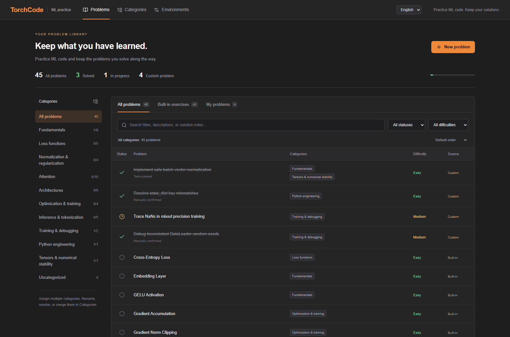
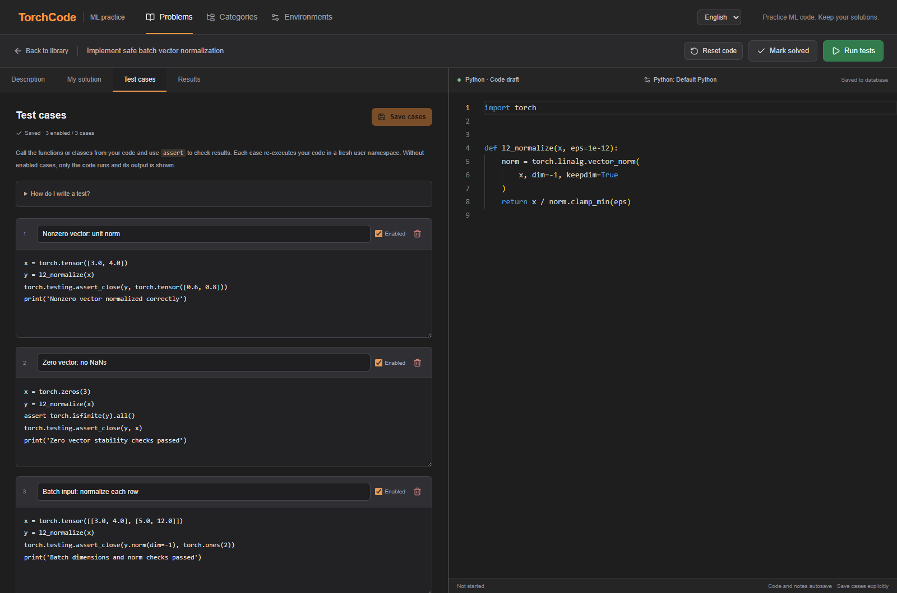
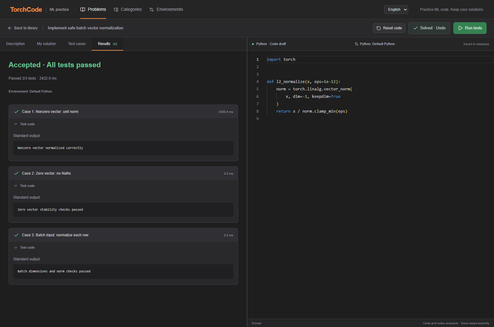
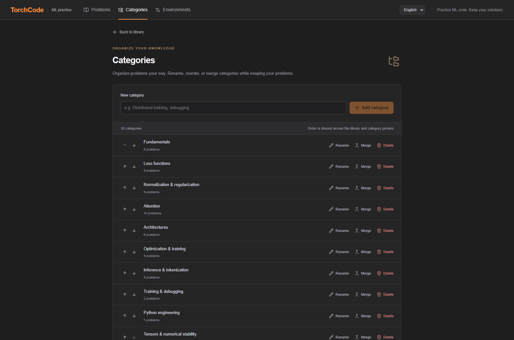
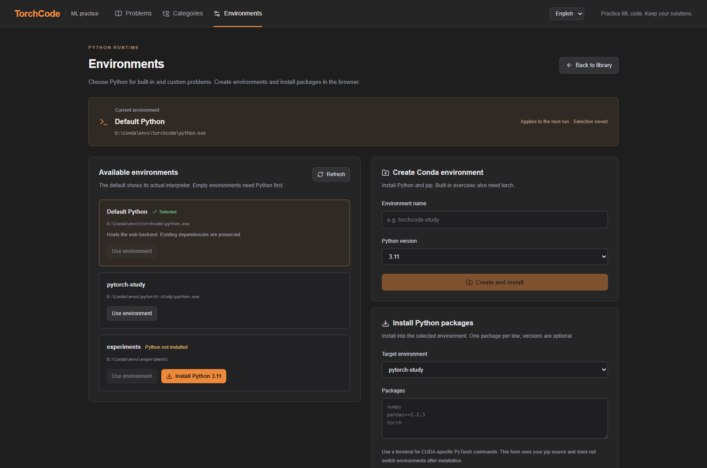

<div align="center">

# TorchCode · Machine Learning Code Practice

**Practice ML code. Keep the problems you have already solved.**

A local workspace to organize coding problems, write solutions and tests, and run them in your own Python environments.

**English** | [简体中文](README.zh-CN.md)

[](LICENSE)
[](https://www.python.org/)
[](https://nextjs.org/)
[](https://github.com/baosen-h/torchcode/actions/workflows/ci.yml)

[Quick start](#quick-start) · [Screenshots](#screenshots) · [Custom tests](#custom-tests) · [Environments](#environments) · [Upstream project](https://github.com/duoan/TorchCode)

</div>



TorchCode is a personal workspace for **machine learning coding practice and engineering notes**. Add your own problems for Python algorithms, NumPy numerical computing, scikit-learn experiments, PyTorch implementations, or training debugging. Custom problems use the dependencies installed in your chosen Python environment. You can record problems without an official answer, keep your solution, and mark them solved manually or through tests.

Built on [duoan/TorchCode](https://github.com/duoan/TorchCode), this version also retains the original **41 PyTorch exercises, automated judge, notebook templates, and reference solutions**. PyTorch is the included exercise collection; custom problems support broader ML practice. The editor and execution engine currently support Python.

## Features

| Feature | What you can do |
| --- | --- |
| Chinese / English interface | Switch language in the header; the browser remembers your choice |
| Personal problem library | Create, edit, and delete problems in the browser, with Markdown, equations, source links, and difficulty |
| Numbered problems and recency | Stable problem numbers, plus the latest open time in the list and problem view |
| Pasted images | Paste or choose images in descriptions and solution notes; images stay with the Markdown and backups |
| Editable categories | Assign multiple categories; create, rename, reorder, merge, or delete categories |
| Completion tracking | Solved titles appear crossed out; mark custom problems solved manually or by passing tests |
| Code and solution notes | Use Monaco, automatically save code drafts, and write Markdown notes with a preview |
| Custom Python tests | Add, name, edit, enable, disable, and remove test scripts in the browser |
| Execution results | See stdout, errors, tracebacks, per-case outcomes, and timing |
| Python environments | Choose Conda environments, create environments, install Python and packages, and read installation logs |
| Local storage and backups | Keep data in SQLite; export/import JSON and migrate earlier browser progress |
| Windows launcher | Double-click a batch file to start both services and open the browser |

## Quick start

Requirements: **Python 3.10+, Node.js 20.9+, and npm**. The Windows launcher and browser-based Conda management also need Miniconda or Anaconda.

```bash
git clone https://github.com/baosen-h/torchcode.git
cd torchcode
conda create -n torchcode python=3.11 pip -y
conda activate torchcode
python -m pip install -r api/requirements.txt
python -m pip install torch
cd web
npm ci
cd ..
```

The current backend needs `torch` to load the included exercise collection. Separate environments used for custom problems only need the packages those problems require. The command above installs PyTorch from your configured pip source; for a particular CUDA build, use the [official PyTorch installation instructions](https://pytorch.org/get-started/locally/).

### Windows: double-click to start

Double-click **[start_torchcode.bat](start_torchcode.bat)** in the repository root.

The launcher checks dependencies, starts the backend using the `torchcode` environment by default, starts the frontend, and opens <http://127.0.0.1:3000/problems>. Keep the launcher window open. Press Enter to stop the services it started.

- Services running the current code for this project are reused. When backend code changes, the launcher restarts the verified old backend; a running code or installation job must finish first. Reused services remain running when the launcher exits.
- If another application occupies a port, the launcher reports the conflict without terminating it.
- Startup logs are saved under `data/startup-logs/`.
- If Conda cannot be found, run from Anaconda Prompt or set `TORCHCODE_CONDA_EXE` to the full path of `conda.exe`.

Optional arguments:

```powershell
.\start_torchcode.bat -BackendPort 8001 -FrontendPort 3001
.\start_torchcode.bat -CheckOnly
```

### Manual startup: Windows / Linux / macOS

Start the backend from the repository root:

```bash
conda activate torchcode
python -m uvicorn api.main:app --host 127.0.0.1 --port 8000
```

In another terminal, start the frontend:

```bash
cd web
npm run dev
```

Open <http://localhost:3000>. For a production build, run `npm run build`, followed by `npm start`, inside `web`.

You can also start manually with an existing Python installation or `venv`. The backend's Python is the default execution environment.

## Screenshots

These screenshots show the current application with an isolated demonstration library. Environment names and paths are illustrative. This README uses the English interface; the [Chinese README](README.zh-CN.md) has separate Chinese screenshots. Use the language selector in the header to switch at any time. Your preference is remembered across refreshes and synchronized across tabs. Problem content, custom category names, notes, code, and program output remain as written; default category names follow the interface language.

### Code and editable test cases

Implement a function on the right and write test scripts on the left. Running also saves pending test edits.



### Test results and completion

Passing every enabled case marks a custom problem solved. Each case shows its result, timing, output, and any error.



### Category management

Rename, reorder, merge, or remove categories. Deleting a category keeps its problems.



### Environment management

Open “Environments” from the top navigation or the environment link above the editor.



## Problem numbers, recent activity, and images

Built-in numbers follow the upstream notebook filenames. Custom problems receive stable, increasing numbers. Deleted numbers are not reused; backups preserve numbers where available and allocate a new number if another problem already uses it. Opening a problem records its latest open time; choose **Last opened** in the library sort menu to return to recent work. Existing open times stay blank until the first visit after this upgrade.

Paste an image into the description editor or solution notes with **Ctrl+V**, or use the image button to choose a file. PNG, JPEG, WebP, and GIF are supported, up to **10 MB per image**. Images are stored separately from Markdown; each insertion uses a short image URL and leaves the cursor on the next line for writing. Markdown fields support up to 5,000,000 characters of text. Notes autosave; save the problem form to store description changes. Preview notes or view the saved description to see the image. Image bytes are kept in SQLite and included in JSON backups. Existing inline image data is converted to short references automatically, with the image preserved. Backup import accepts files up to 100 MB.

The library has a dedicated Last opened column; unvisited problems show Not opened yet. Its Source column displays clickable URLs and links built-in problems to the upstream repository. Custom sources stay empty until you enter a URL in the problem form.

## Custom tests

Custom tests can check any Python function or class. Use plain `assert`, `numpy.testing.assert_allclose`, or `torch.testing.assert_close`, depending on the problem. Install the required packages in the selected execution environment.

For example, implement this in the editor:

```python
def add(a, b):
    return a + b
```

Then add a script in the “Test cases” tab:

```python
assert add(1, 2) == 3
assert add(-1, 1) == 0
print("Addition tests passed")
```

- **No enabled cases:** “Run code” runs the code and shows output or exceptions. A successful run alone does not mark the problem solved.
- **Enabled cases:** “Run tests” checks them and marks the problem solved when they all pass. Changing previously passed cases requires another run; manually confirmed completion is preserved.
- Every custom case re-executes the current code in a fresh user namespace. Test scripts can directly call its functions, classes, and imported modules.
- Save cases explicitly or run to save them. Up to 50 cases are supported. Code and notes save automatically; unsaved case drafts are cached in the current browser.
- Included PyTorch exercises retain their original judge scripts.

Code runs in a separate Python process with a default 30-second timeout. Set `TORCHCODE_RUN_TIMEOUT` to a value from 1 to 120 seconds to change it. Process separation provides timeout control; **it is not a security sandbox**. Code runs with your local user's permissions. Use this application locally, run trusted code, and do not expose it directly to the public internet.

## Environments

The selected environment applies to the next run of either a built-in or custom problem, and the selection is remembered. The web backend keeps its own Python environment.

1. Choose an existing Conda environment and click “Use this environment”.
2. Install Python into an empty environment, or create a new environment with a Python version of your choice.
3. In “Install Python packages”, choose the target and enter one package per line, such as `numpy`, `scikit-learn`, `pandas==2.2.3`, or `torch`.
4. Wait for the installation log to report success, then select that environment for execution. The included PyTorch exercises need `torch` installed in that environment.

Only one installation job runs at a time. Code execution pauses during installation, and installation cannot start while code is running. Package installation is unavailable for the backend and base environments. Installation requires a network connection and a running backend. Failed jobs may leave a partially updated environment; inspect the log before retrying.

The package form accepts package names and version constraints. Configure CUDA-specific builds, extra package indexes, or other advanced installation commands in a terminal, then select that environment in the browser.

## Data and backups

- The default database is `data/library.db`, containing custom problems, categories, cases, code drafts, notes, and progress.
- Export or import JSON from the problem library footer. Import merges records. Python installations and dependencies are not part of a library backup.
- On first visit, earlier browser-based code drafts and solved records from the same origin are migrated.
- New database fields are added at backend startup while existing records are preserved.
- Local databases, environment settings, installation logs, dependencies, and build outputs are excluded from Git.

See the [web usage guide in Chinese](web/README.md) for additional configuration and migration details.

## Development and checks

```bash
python -m pip install -r api/requirements-dev.txt
python -m pip install torch
python -m unittest discover -s api/tests -v
cd web
npm run lint
npm run build
```

The repository includes 55 backend regression tests. GitHub Actions checks API tests and frontend lint/build. Installation tests use simulated commands and do not download packages or modify developers' Conda environments.

```text
api/                  FastAPI, SQLite, execution workers, environments, tests
web/                  Next.js / React application
torch_judge/          Upstream judge and included PyTorch problems
templates/            Upstream notebook templates
solutions/            Upstream reference implementations
scripts/start-web.ps1 Windows service launcher
assets/screenshots/en/   Screenshots of this version
data/                 Local data and logs, excluded from Git
```

The upstream Jupyter/Docker workflow remains available in the [archived upstream README](README.upstream.md). That archive describes the original PyTorch-focused project; its Hugging Face metadata and introduction are historical, not the current homepage. The existing Docker configuration starts JupyterLab. Start this web application with the commands above.

## Attribution and license

Thanks to [duoan/TorchCode](https://github.com/duoan/TorchCode) and its contributors. This personal adaptation reuses upstream code, problems, and reference implementations. It is shared for others who find it useful. The broader ML practice workspace, personal library, and environment features are maintained by [baosen-h](https://github.com/baosen-h). This is an independently maintained derivative.

The upstream README and package metadata declare MIT. This repository also uses the [MIT License](LICENSE), with upstream author and contributor attribution retained. See [NOTICE.md](NOTICE.md) for provenance and details of the supplied license text.

### Repository history

This repository starts from an independent snapshot commit. Upstream Git history is not included on the default branch. GitHub's Contributors list therefore reflects this repository's commits; it does not credit authorship of all the included code. The original project and its contributors remain credited here, in NOTICE, and in the MIT license. A GitHub fork is optional and is not required to reuse MIT-licensed code with its notices preserved.
