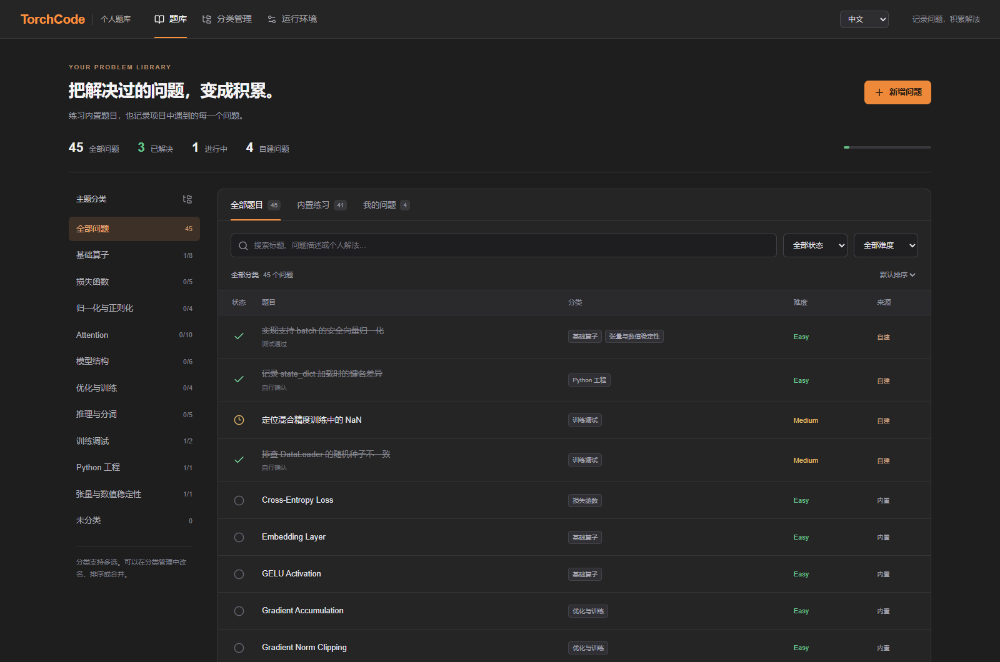
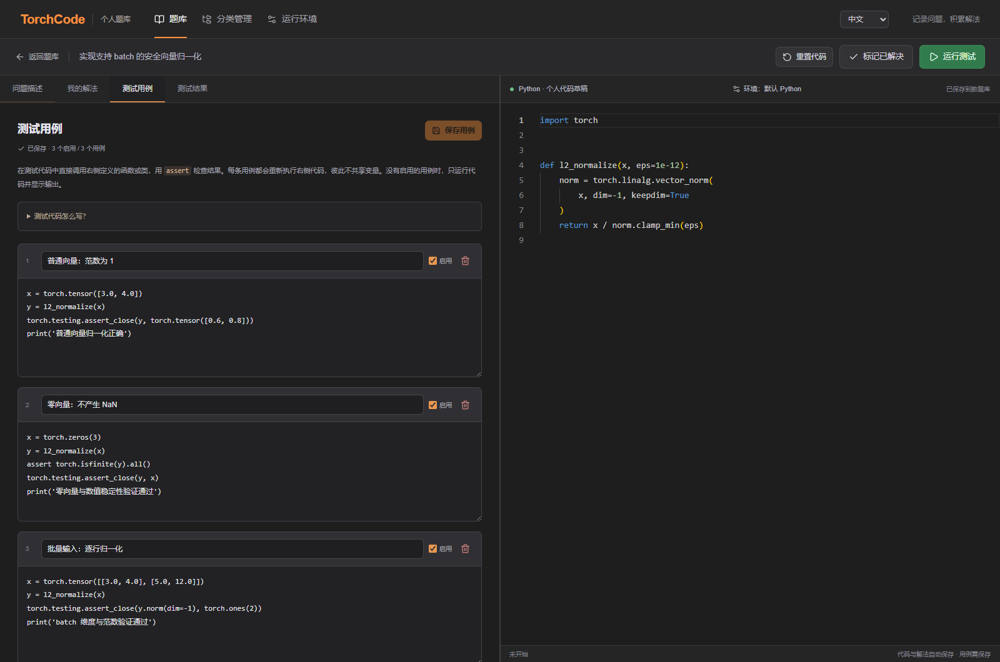
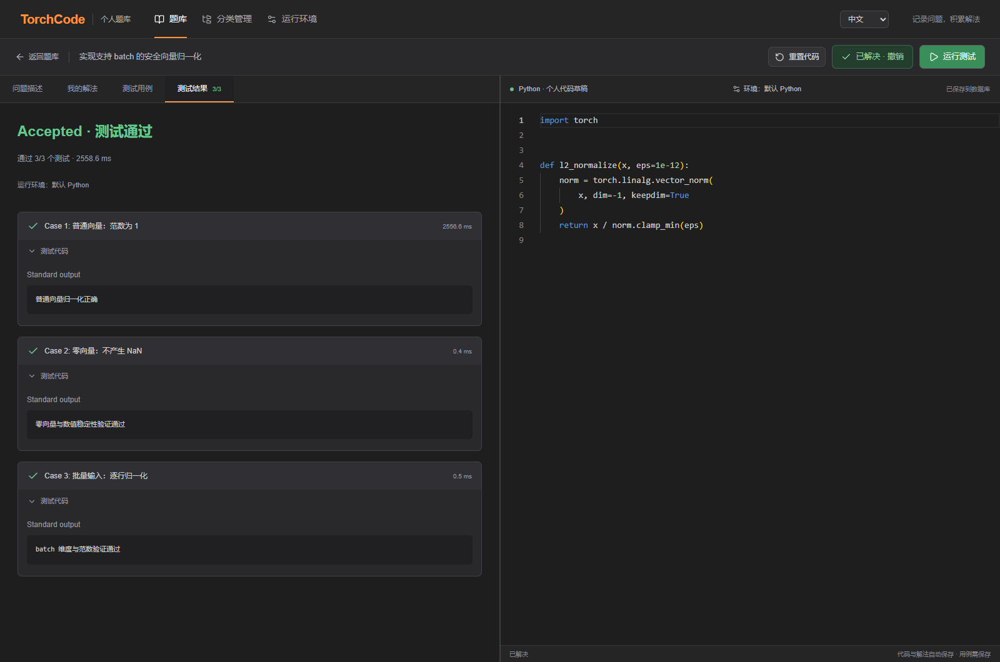
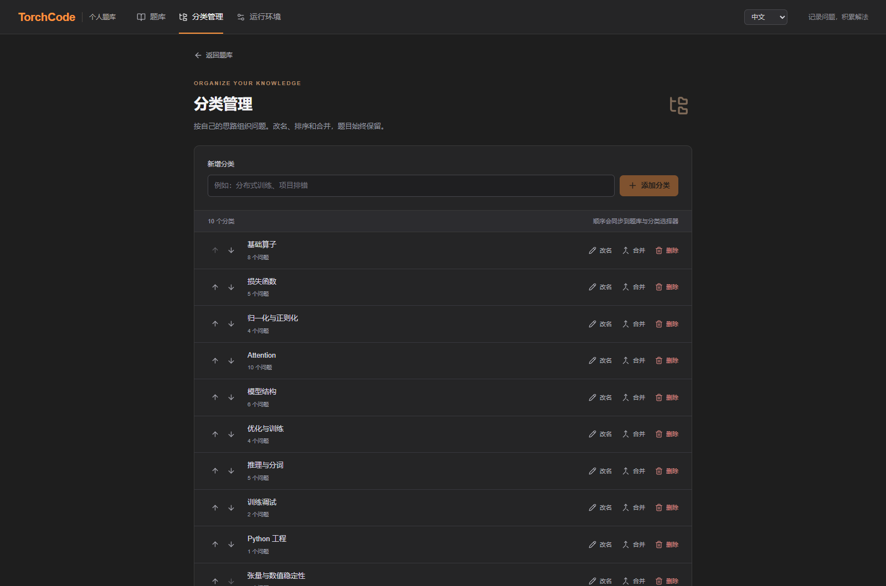
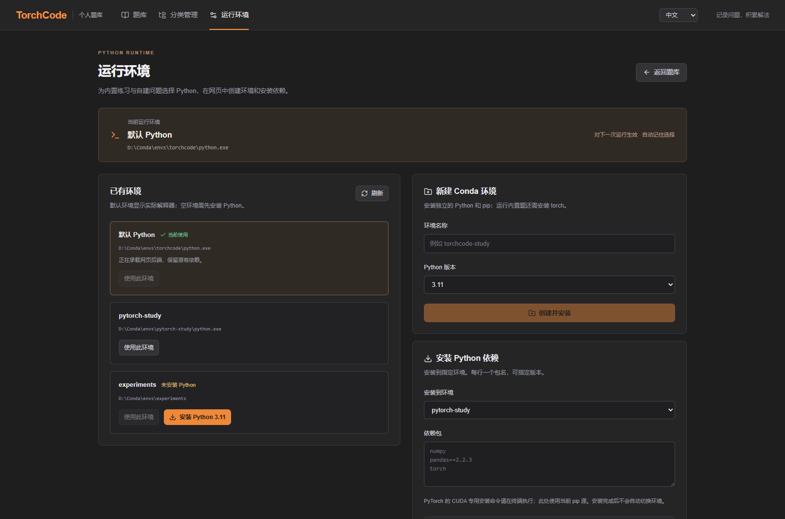

<div align="center">

# TorchCode · 机器学习代码练习与个人题库

**练习机器学习代码，也记住自己解决过的问题。**

在浏览器中练习机器学习算法、数值计算与训练工程，管理题目、记录解法、编写测试，并选择本机 Python 环境运行。

[English](README.md) | **简体中文**

[](LICENSE)
[](https://www.python.org/)
[](https://nextjs.org/)
[](https://github.com/baosen-h/torchcode/actions/workflows/ci.yml)

[快速开始](#快速开始) · [界面预览](#界面预览) · [自定义测试](#自定义测试) · [环境管理](#环境管理) · [上游项目](https://github.com/duoan/TorchCode)

</div>



TorchCode 是面向 **机器学习代码练习与工程问题积累** 的本地个人题库。自建题不限定框架：可以练习纯 Python 算法、NumPy 数值计算、scikit-learn 实验、PyTorch 模型实现或训练调试，运行时使用所选 Python 环境中已安装的依赖。没有官方答案的问题也可以收录，记录自己的解决过程，再通过手动确认或自定义测试标记完成。

本项目基于 [duoan/TorchCode](https://github.com/duoan/TorchCode) 扩展，保留 **41 道内置 PyTorch 练习、自动判题、Notebook 模板和参考实现**。PyTorch 是随项目提供的一套内置题集；自建题目可用于更广泛的机器学习代码练习。目前代码编辑器与执行器支持 Python。

## 功能

| 功能 | 使用方式 |
| --- | --- |
| 中英文界面 | 顶部切换中文 / English，浏览器记住选择并同步到其他标签页 |
| 个人题库 | 网页新增、编辑、删除问题，支持 Markdown、公式、来源链接和难度 |
| 问题编号与最近打开 | 编号稳定保留；题库和题目详情显示最近打开时间 |
| 粘贴图片 | 在问题描述和解法中粘贴或选择图片；图片随 Markdown 和备份一起保存 |
| 分类管理 | 多分类归属，新增、重命名、排序、合并、删除分类 |
| 完成记录 | 已解决题目划线显示；自建问题可手动确认，也可由测试自动完成 |
| 代码与解法 | Monaco 编辑器、代码草稿自动保存、Markdown 解法和预览 |
| 自定义测试 | 网页添加、编辑、命名、启停、删除 Python 断言用例 |
| 运行结果 | 标准输出、错误堆栈、每条用例的通过状态与耗时 |
| 运行环境 | 切换 Conda 环境，创建环境、安装 Python 和依赖，查看安装日志 |
| 本地持久化 | SQLite 保存题库，支持 JSON 导出、导入及旧版网页进度迁移 |
| Windows 启动 | 双击 `.bat` 启动前后端并打开浏览器 |

## 快速开始

需要 **Python 3.10+、Node.js 20.9+ 和 npm**。下面的 `torch` 用于当前后端加载内置题集；自建题的独立执行环境可以只安装自身需要的依赖。Windows 一键启动及网页 Conda 管理还需要安装 Miniconda 或 Anaconda。

```bash
git clone https://github.com/baosen-h/torchcode.git
cd torchcode
conda create -n torchcode python=3.11 pip -y
conda activate torchcode
python -m pip install -r api/requirements.txt
python -m pip install torch
cd web
npm ci
cd ..
```

上面的 `torch` 使用当前 pip 源的默认安装方式。需要特定 CUDA 版本时，请按照 [PyTorch 官方安装页](https://pytorch.org/get-started/locally/)选择对应命令。

### Windows：双击启动

双击仓库根目录的 **[start_torchcode.bat](start_torchcode.bat)**。

启动器检查依赖，默认从 `torchcode` 环境启动后端，启动前端并打开 <http://127.0.0.1:3000/problems>。保持启动窗口开启，按回车停止本次启动的服务。

- 已在运行的本项目服务会复用；退出时保留复用的服务。
- 其他程序占用端口时显示提示，不结束其他程序。
- 启动日志保存在 `data/startup-logs/`。
- 找不到 Conda 时，从 Anaconda Prompt 运行，或设置 `TORCHCODE_CONDA_EXE` 为 `conda.exe` 的完整路径。

可选启动参数：

```powershell
.\start_torchcode.bat -BackendPort 8001 -FrontendPort 3001
.\start_torchcode.bat -CheckOnly
```

### 手动启动：Windows / Linux / macOS

在仓库根目录启动后端：

```bash
conda activate torchcode
python -m uvicorn api.main:app --host 127.0.0.1 --port 8000
```

另开终端启动前端：

```bash
cd web
npm run dev
```

打开 <http://localhost:3000>。生产构建使用 `npm run build`，然后 `npm start`。

不用 Conda 时也可使用已有 Python 或 `venv` 手动启动；默认执行环境就是后端 Python。

## 界面语言

顶部可随时切换 **中文 / English**，浏览器会记住选择，刷新后保持，并同步到其他标签页。切换语言保留正在填写的表单、代码、解法和测试用例草稿。

界面按钮、提示、应用错误及默认分类名称会随语言切换；自建题目、自定义分类名称、个人笔记、代码和程序输出保留原文，不自动翻译。本页使用中文截图，[英文 README](README.md) 使用独立的英文截图。

## 界面预览

以下为实际页面截图，使用独立的演示题库。环境名称和路径为示例。

### 编辑代码与自定义用例

右侧实现函数，左侧添加测试脚本；运行时会先保存用例。



### 查看结果并记录完成

启用的用例全部通过后自动标记完成，每条用例可查看测试代码、输出和错误。



### 调整分类

分类可以重命名、移动、合并和删除；删除分类会保留其中的题目。



### 选择和安装环境

在顶部“运行环境”或题目编辑器的环境入口中管理本机 Python。



## 编号、最近打开与粘贴图片

内置题编号对应上游 Notebook 文件名；自建题使用稳定递增的编号，删除后不复用。备份恢复时优先保留原编号；若与其他题冲突，会为导入题分配新编号。打开题目后会记录最近打开时间，题库排序中可选择“最近打开”。升级前未记录的打开时间先留空。

在编辑问题描述或个人解法时，直接 **Ctrl+V 粘贴图片**，或点击图片按钮选择文件。支持 PNG、JPEG、WebP、GIF，**单张最大 1 MB**，每个 Markdown 字段最多 500 万字符。解法自动保存，描述需保存问题表单；点击解法预览或查看已保存的问题描述即可看到图片。图片嵌入 Markdown，随 SQLite 和 JSON 备份一起保存，备份导入上限为 100 MB。

列表“来源”会跳转到链接。内置题统一指向上游 GitHub，自建题在未填写来源时留空，之后可在编辑问题中补充。

## 自定义测试

自建题可以验证任意 Python 函数或类。纯 Python 用 `assert`，NumPy 可用 `numpy.testing.assert_allclose`，PyTorch 可用 `torch.testing.assert_close`，所需依赖安装在选中的运行环境中。

例如，在代码编辑器中实现：

```python
def add(a, b):
    return a + b
```

进入“测试用例”，添加测试脚本：

```python
assert add(1, 2) == 3
assert add(-1, 1) == 0
print("加法测试通过")
```

- **没有启用的用例**：按钮显示“运行代码”，展示输出或异常；运行成功不会自动标记解决。
- **有启用的用例**：按钮显示“运行测试”，全部通过后自动完成。修改已通过的用例后需要重新测试；手动确认的完成状态保留。
- 每条自定义用例会重新执行当前代码，用户变量互不共享。可以直接调用函数、类和已导入模块，张量比较可使用 `torch.testing.assert_close`。
- 用例可手动保存，点击运行时也会保存；最多 50 条。代码和个人解法自动保存，未保存的用例草稿保留在当前浏览器。
- 内置练习继续使用原有判题脚本。

题目在独立 Python 进程中执行，默认超时 30 秒，可通过 `TORCHCODE_RUN_TIMEOUT` 调整为 1–120 秒。独立进程用于控制超时，**并非安全沙箱**：代码仍具有当前本机用户的权限。本项目面向本机个人使用，请只运行可信代码，不直接暴露到公网。

## 环境管理

环境切换适用于内置题和自建题，对下一次运行生效，选择自动记住。网页服务保持原来的后端 Python。

1. 选择已有 Conda 环境，点击“使用此环境”。
2. 空环境需先安装 Python；也可以新建一个独立环境。
3. 在“安装 Python 依赖”中选择目标环境，每行输入一个包名或版本条件，例如 `numpy`、`pandas==2.2.3` 或 `torch`。
4. 等待安装日志显示成功，再选择该环境运行题目。内置 PyTorch 练习需要目标环境已安装 `torch`。

一次只执行一个安装任务。安装期间暂停运行题目，有代码运行时不能开始安装。后端环境及 base 不提供依赖安装入口。安装需要联网，服务需保持运行；失败时请检查日志，环境可能已经部分更新。

安装表单接受包名及版本条件；CUDA 专用安装命令、额外安装源等在终端中配置，之后可直接从网页选择对应环境。

## 数据与备份

- 默认题库数据库：`data/library.db`，包含自建问题、分类、用例、代码草稿、解法和完成状态。
- 题库页底部支持导出／导入 JSON，导入时合并更新；本机解释器和依赖不包含在题库备份中。
- 第一次访问新版网页会迁移当前浏览器来源中的旧版草稿与完成记录。
- 新功能所需的数据库字段在后端启动时自动添加，已有记录保留。
- 数据库、环境配置、安装日志、构建产物和依赖目录均不提交到 Git。

更多启动参数、保存机制和迁移说明见 [网页使用文档](web/README.md)。

## 开发与验证

```bash
python -m pip install -r api/requirements-dev.txt
python -m pip install torch
python -m unittest discover -s api/tests -v
cd web
npm run lint
npm run build
```

包含 50 项后端回归测试。GitHub Actions 分别检查后端测试和前端 lint／构建；环境安装测试使用模拟命令，不下载或修改开发者的 Conda 环境。

```text
api/                 FastAPI、SQLite、独立执行进程、环境管理与测试
web/                 Next.js / React 网页
torch_judge/         上游 PyTorch 判题引擎和内置题目
templates/           上游 Notebook 题目模板
solutions/           上游参考实现
scripts/start-web.ps1 Windows 服务启动器
assets/screenshots/zh-CN/  本版本界面截图
data/                本机数据与日志（不入库）
```

上游的 Jupyter / Docker 使用方式保留，详见 [上游原版 README 存档](README.upstream.md)。该存档描述的是原始 PyTorch 项目，开头的 Hugging Face 配置和原始介绍不是当前版本的首页说明。现有 Docker 配置启动的是 JupyterLab，网页版按本文步骤启动。

## 来源与许可

感谢 [duoan/TorchCode](https://github.com/duoan/TorchCode) 及其所有贡献者。这是基于上游代码、题目与参考实现的个人改版，分享给有相似需求的人使用。个人题库和环境管理等扩展由 [baosen-h](https://github.com/baosen-h) 维护，并非上游官方站点。

上游在 README 和包元数据中声明 MIT。本仓库同样采用 [MIT License](LICENSE)，保留原作者及贡献者署名；上游文件来源和许可证补充说明见 [NOTICE.md](NOTICE.md)。

## 仓库历史

本仓库从独立快照提交开始，默认分支不包含上游 Git 历史。GitHub 的 Contributors 展示本仓库的提交作者，不代表所含代码全部由这些人原创。上游原作者和贡献者仍在本文、NOTICE 和 MIT 许可证中明确致谢。保留许可证及署名后使用 MIT 代码，无需必须建立 GitHub Fork 关系。
